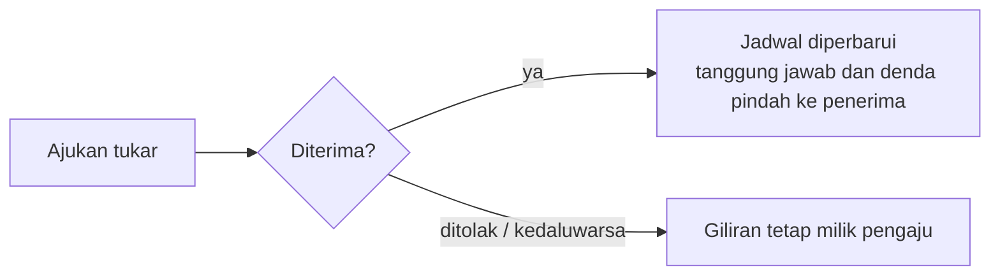
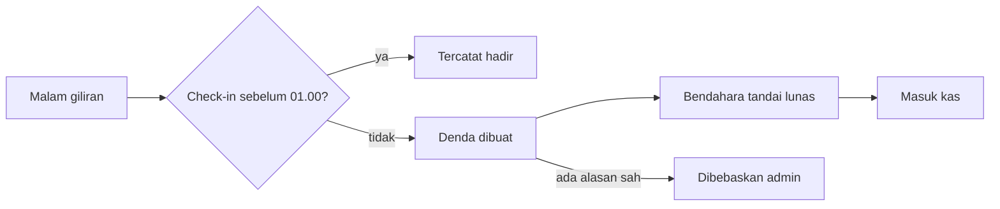

# PRD RondaKu

Tanggal: 7 November 2026

---

## 1. Ringkasan Produk

RondaKu adalah aplikasi mobile untuk mengelola siskamling di tingkat RT/RW: jadwal giliran tetap, tukar giliran, absensi, denda otomatis, dan pencatatan kas yang transparan.

**Latar belakang & masalah**

- Jadwal ronda dicatat manual (kertas atau grup WhatsApp), sehingga mudah lupa dan sulit dilacak.
- Tukar giliran dilakukan lisan, tanpa catatan siapa yang seharusnya bertugas.
- Kehadiran tidak terverifikasi, sehingga denda sulit ditegakkan secara adil.
- Uang denda dan kas tidak tercatat rapi, rawan salah paham antarwarga.
- Saat ada kejadian darurat, tidak ada cara cepat memberi tahu petugas dan tetangga.

## 2. Tujuan & Metrik Sukses

Tujuan utama: setiap malam ada petugas ronda yang hadir dan terverifikasi, dengan pencatatan denda dan kas yang bisa dilihat semua warga.

| Tujuan | Metrik | Target (3 bulan setelah rilis) |
| --- | --- | --- |
| Kehadiran ronda naik | % giliran dengan check-in | ≥ 85% |
| Adopsi oleh warga | % warga wajib ronda yang aktif di aplikasi | ≥ 80% |
| Tukar giliran tercatat | % tukar giliran lewat aplikasi | ≥ 90% |
| Kas transparan | Selisih kas fisik vs catatan | Rp0 saat rekap bulanan |
| Respons darurat cepat | Waktu dari SOS ke respons petugas | < 5 menit |

**Di luar cakupan (non-goals)**

- Integrasi langsung dengan kepolisian atau CCTV.
- Pembayaran digital terintegrasi (payment gateway) pada versi pertama.
- Pengelolaan administrasi RT lain (surat pengantar, iuran sampah, dan sebagainya).

## 3. Pengguna & Peran

Ada empat peran. Satu orang bisa punya lebih dari satu peran, misalnya bendahara yang juga wajib ronda.

| Peran | Siapa | Hak akses utama |
| --- | --- | --- |
| Admin | Ketua RT / koordinator ronda | Kelola data warga, buat jadwal, atur nominal denda, setujui tukar giliran, bebaskan denda, kirim pengumuman |
| Bendahara | Bendahara RT | Tandai pembayaran denda, verifikasi bukti transfer, catat pemasukan dan pengeluaran kas, ekspor rekap |
| Petugas ronda | Warga wajib ronda | Lihat jadwal, ajukan atau terima tukar giliran, check-in, isi log jaga, lapor kejadian |
| Warga | Semua warga terdaftar (termasuk lansia/non-wajib) | Lihat jadwal dan kas, tombol SOS, lapor kejadian dan tamu, terima pengumuman |

**Karakteristik pengguna:** usia beragam (20–70 tahun), sebagian besar memakai HP Android kelas menengah ke bawah, dan tidak semua terbiasa dengan aplikasi. Tampilan harus sederhana, dengan tombol besar dan Bahasa Indonesia yang jelas.

## 4. Kebutuhan Fungsional

Prioritas: **P0** = wajib di MVP, **P1** = rilis berikutnya, **P2** = nanti.

### 4.1 Jadwal Ronda

| ID | Kebutuhan | Prioritas |
| --- | --- | --- |
| JD-01 | Admin membuat jadwal tetap (per hari dalam seminggu atau rotasi mingguan) yang berulang otomatis | P0 |
| JD-02 | Admin mengatur pos ronda, jumlah petugas per malam, dan jam ronda (misalnya 22.00–04.00) | P0 |
| JD-03 | Warga melihat "Giliran saya berikutnya" dan kalender jadwal semua petugas | P0 |
| JD-04 | Pengingat otomatis H-1 dan 2 jam sebelum giliran (notifikasi aplikasi) | P0 |
| JD-05 | Admin bisa mengubah jadwal manual, dengan perubahan tercatat di riwayat | P0 |

### 4.2 Tukar / Pindah Giliran

| ID | Kebutuhan | Prioritas |
| --- | --- | --- |
| TG-01 | Petugas mengajukan **tukar** (saling bertukar tanggal) dengan petugas tertentu | P0 |
| TG-02 | Petugas mengajukan **digantikan** (orang lain mengambil giliran tanpa balasan) | P0 |
| TG-03 | Penerima mendapat notifikasi (notifikasi aplikasi) dan bisa Terima atau Tolak | P0 |
| TG-04 | Jika diterima, jadwal berubah otomatis dan kedua pihak serta admin mendapat notifikasi | P0 |
| TG-05 | Batas waktu pengajuan (default H-1 pukul 18.00, bisa diatur admin) | P0 |
| TG-06 | Permintaan terbuka: diajukan ke semua petugas, siapa cepat dia dapat | P1 |
| TG-07 | Opsi persetujuan admin sebelum tukar berlaku | P1 |
| TG-08 | Pencatatan "utang giliran" untuk jenis digantikan | P1 |

### 4.3 Absensi (Check-in)

| ID | Kebutuhan | Prioritas |
| --- | --- | --- |
| AB-01 | Petugas check-in dengan scan QR code di pos ronda | P0 |
| AB-02 | Validasi lokasi GPS dalam radius pos (default 100 m) saat check-in | P0 |
| AB-03 | Check-in hanya bisa dilakukan dalam rentang jam ronda | P0 |
| AB-04 | Sistem otomatis menandai "Tidak hadir" jika tidak check-in sampai batas jam (default 01.00) | P0 |
| AB-05 | Checkpoint patroli: scan QR di beberapa titik keliling | P2 |

### 4.4 Denda

| ID | Kebutuhan | Prioritas |
| --- | --- | --- |
| DN-01 | Admin mengatur nominal denda per ketidakhadiran | P0 |
| DN-02 | Denda otomatis dibuat saat status "Tidak hadir" | P0 |
| DN-03 | Denda dibebankan ke pemegang giliran terakhir (setelah tukar) | P0 |
| DN-04 | Admin bisa membebaskan denda dengan alasan wajib diisi | P0 |
| DN-05 | Warga melihat daftar denda miliknya beserta status | P0 |
| DN-06 | Notifikasi saat denda dibuat, dan pengingat jika belum dibayar lebih dari 7 hari (notifikasi aplikasi) | P0 |

### 4.5 Pencatatan Kas

| ID | Kebutuhan | Prioritas |
| --- | --- | --- |
| KS-01 | Daftar denda dengan status Belum bayar / Menunggu verifikasi / Lunas | P0 |
| KS-02 | Bendahara menandai lunas untuk pembayaran tunai | P0 |
| KS-03 | Warga mengunggah bukti transfer, lalu bendahara memverifikasi | P1 |
| KS-04 | Denda lunas otomatis masuk sebagai pemasukan kas | P0 |
| KS-05 | Bendahara mencatat pemasukan lain (iuran, jimpitan) dan pengeluaran (konsumsi, alat) dengan foto nota | P0 |
| KS-06 | Buku kas dengan saldo berjalan, bisa dilihat semua warga (hanya baca) | P0 |
| KS-07 | Rekap bulanan: total denda, lunas, tunggakan per warga, pemasukan, pengeluaran | P0 |
| KS-08 | Ekspor rekap ke PDF dan Excel | P1 |

### 4.6 Keamanan & Darurat

| ID | Kebutuhan | Prioritas |
| --- | --- | --- |
| DR-01 | Tombol SOS: notifikasi (notifikasi aplikasi) ke petugas yang bertugas malam itu, admin, dan warga sekitar, beserta link lokasi Google Maps | P1 |
| DR-02 | Laporan kejadian dengan kategori, foto, lokasi, dan waktu | P1 |
| DR-03 | Daftar kontak darurat (polsek, damkar, ambulans, ketua RT) yang bisa langsung ditelepon | P1 |
| DR-04 | Log jaga per shift (aman / ada temuan + catatan) | P1 |
| DR-05 | Laporan tamu menginap | P2 |

### 4.7 Data Warga, Pengumuman & Riwayat

| ID | Kebutuhan | Prioritas |
| --- | --- | --- |
| DW-01 | Admin menambah, mengubah, dan menonaktifkan data warga (nama, no. HP, alamat, status wajib ronda) | P0 |
| DW-02 | Login dengan nomor HP + PIN 6 digit, tanpa OTP dan tanpa SMS. Warga membuat PIN saat pertama kali masuk setelah didaftarkan admin | P0 |
| DW-06 | Lupa PIN: admin mereset PIN warga, lalu warga membuat PIN baru saat login berikutnya | P0 |
| DW-07 | Sesi login tetap tersimpan di HP sampai warga keluar, agar tidak perlu memasukkan PIN setiap membuka aplikasi | P0 |
| DW-05 | Verifikasi SMS opsional (aktivasi akun, login di HP baru, reset PIN mandiri) — **pengembangan berikutnya, tidak di MVP** | P2 |
| DW-03 | Pengumuman dari admin ke semua warga | P1 |
| DW-04 | Riwayat perubahan (audit log): siapa, apa, kapan untuk jadwal, tukar, denda, pembebasan denda, dan kas | P0 |

### 4.8 Notifikasi

Di MVP, notifikasi **hanya lewat aplikasi**. WhatsApp disiapkan sebagai pengembangan berikutnya.

| Kanal | Status | Keterangan |
| --- | --- | --- |
| **Aplikasi** (push notification + kotak masuk di aplikasi) | MVP, selalu aktif | Kanal utama dan gratis. Semua notifikasi juga tersimpan di menu Notifikasi agar bisa dibaca ulang |
| **WhatsApp** | Pengembangan berikutnya (tidak di MVP) | Opsional, bisa diaktifkan / dinonaktifkan. Berbayar per pesan |

| ID | Kebutuhan | Prioritas |
| --- | --- | --- |
| NT-01 | Push notification untuk semua kejadian di daftar notifikasi | P0 |
| NT-02 | Kotak masuk notifikasi di aplikasi (riwayat, tanda sudah/belum dibaca, ketuk untuk membuka detail) | P0 |

#### Rencana WhatsApp (pengembangan berikutnya, tidak di MVP)

Bagian ini dicatat agar desain MVP tidak menutup jalan untuk WhatsApp nanti, tetapi **tidak dikembangkan sekarang**.

**Pengaturan WhatsApp dua tingkat**

1. **Tingkat RT (admin):** saklar utama "Notifikasi WhatsApp" Aktif / Nonaktif. Jika nonaktif, tidak ada pesan WhatsApp sama sekali untuk RT tersebut. Admin juga bisa memilih jenis notifikasi mana saja yang dikirim lewat WhatsApp.
2. **Tingkat warga:** jika WhatsApp aktif di RT-nya, setiap warga bisa menyalakan atau mematikan WhatsApp untuk dirinya sendiri di menu Profil > Notifikasi.

Pesan WhatsApp terkirim hanya jika **saklar RT aktif + jenis notifikasi dipilih admin + warga mengaktifkan**. Notifikasi aplikasi tetap terkirim apa pun pengaturannya.

**Pendekatan teknis WhatsApp:** WhatsApp Business Platform (Cloud API) resmi dari Meta, langsung atau melalui penyedia resmi (BSP) di Indonesia. Pesan wajib memakai **template yang sudah disetujui Meta** dan dikenai biaya per pesan.

| ID | Kebutuhan | Prioritas |
| --- | --- | --- |
| NT-03 | Admin menyalakan / mematikan WhatsApp untuk seluruh RT | P2 |
| NT-04 | Admin memilih jenis notifikasi yang dikirim lewat WhatsApp | P2 |
| NT-05 | Warga menyalakan / mematikan WhatsApp untuk dirinya sendiri (default: aktif jika RT mengaktifkan) | P2 |
| NT-06 | Satu nomor WhatsApp Business resmi sebagai pengirim | P2 |
| NT-07 | Template WhatsApp per jenis notifikasi, dengan variabel nama, tanggal, pos, nominal | P2 |
| NT-08 | Status pengiriman WhatsApp tercatat (terkirim, dibaca, gagal); kirim ulang maksimal 2 kali | P2 |
| NT-09 | Tombol Terima / Tolak langsung di pesan WhatsApp tukar giliran | P2 |
| NT-10 | Ringkasan jumlah pesan WhatsApp per bulan untuk admin (memantau biaya) | P2 |

**Daftar notifikasi**

Kolom Aplikasi = dikirim di MVP. Kolom WhatsApp = bisa ditambahkan saat WhatsApp dikembangkan nanti.

| Kejadian | Penerima | Isi pesan (ringkas) | Aplikasi | WhatsApp | Prioritas |
| --- | --- | --- | --- | --- | --- |
| H-1 giliran | Petugas | Giliran besok, jam, pos | Ya | Nanti | P0 |
| 2 jam sebelum giliran | Petugas | Pengingat mulai ronda | Ya | Nanti | P0 |
| Permintaan tukar masuk | Penerima | Siapa mengajukan, tanggal, tombol Terima / Tolak | Ya | Nanti | P0 |
| Tukar diterima / ditolak / kedaluwarsa | Pengaju (+ admin jika diterima) | Hasil permintaan dan jadwal terbaru | Ya | Nanti | P0 |
| Tidak check-in sampai batas | Petugas | Tercatat tidak hadir, denda Rp... | Ya | Nanti | P0 |
| Denda dibebaskan | Petugas | Denda dibebaskan + alasan | Ya | Nanti | P0 |
| Pembayaran denda lunas | Petugas | Konfirmasi lunas | Ya | Nanti | P0 |
| Denda belum dibayar > 7 hari | Petugas | Pengingat tunggakan | Ya | Nanti | P0 |
| Rekap kas bulanan | Semua warga | Ringkasan saldo + link rekap | Ya | Nanti | P1 |
| Pengumuman | Semua warga | Isi pengumuman | Ya | Nanti | P1 |
| SOS | Petugas malam itu, admin, warga sekitar | Nama pelapor, link lokasi | Ya | Nanti | P1 |

**Catatan desain MVP:** buat layanan notifikasi dengan konsep "kanal" (saat ini hanya `push`), supaya WhatsApp dan SMS bisa ditambahkan nanti tanpa mengubah logika jadwal, tukar giliran, dan denda.

## 5. Alur Utama

Denda hanya muncul jika petugas yang bertugas tidak check-in.

### A. Tukar giliran

### B. Malam ronda

Tukar yang diterima memindahkan tanggung jawab sekaligus risiko denda. Denda yang lunas otomatis menjadi pemasukan kas, sedangkan pembebasan tetap tercatat di riwayat.

## 6. Aturan Bisnis

Semua nilai default di bawah bisa diubah admin di menu Pengaturan.

**Jadwal & tukar giliran**

1. Jadwal tetap berulang sampai admin mengubahnya; perubahan tidak mengubah riwayat yang sudah lewat.
2. Tukar hanya bisa diajukan untuk giliran yang belum lewat dan sebelum batas waktu (default H-1 pukul 18.00).
3. Permintaan yang belum dijawab saat batas waktu otomatis kedaluwarsa; giliran tetap milik pengaju.
4. Satu giliran hanya boleh punya satu permintaan tukar aktif.
5. Setelah tukar diterima, tanggung jawab (termasuk denda) sepenuhnya pindah ke penerima.
6. Pada jenis tukar, kedua tanggal ikut bertukar; pada jenis digantikan, hanya satu tanggal yang pindah.

**Absensi**

1. Check-in sah jika QR pos cocok, lokasi dalam radius, dan waktu dalam jam ronda.
2. Jika GPS gagal, admin bisa menandai hadir manual dengan alasan (tercatat di riwayat).
3. Batas check-in default pukul 01.00; lewat dari itu status menjadi Tidak hadir.

**Denda & kas**

1. Satu ketidakhadiran = satu denda dengan nominal yang berlaku saat itu (perubahan nominal tidak mengubah denda lama).
2. Pembebasan denda hanya oleh admin, alasan wajib diisi, dan tidak bisa dihapus dari riwayat.
3. Status Lunas hanya bisa diberikan bendahara; pembatalan Lunas wajib disertai alasan.
4. Setiap pembayaran denda lunas otomatis menjadi entri pemasukan kas.
5. Entri kas tidak bisa dihapus; koreksi dilakukan dengan entri pembalik agar jejaknya tetap ada.

## 7. Kebutuhan Non-Fungsional

| Aspek | Kebutuhan |
| --- | --- |
| Platform | Android (minimal Android 8) sebagai prioritas; iOS dan web admin menyusul |
| Performa | Aplikasi terbuka < 3 detik di HP kelas menengah; notifikasi SOS terkirim < 10 detik |
| Koneksi | Check-in bisa disimpan saat offline lalu tersinkron otomatis, dengan waktu asli tercatat |
| Notifikasi | MVP: push aplikasi saja (Firebase Cloud Messaging). Pengingat terkirim tepat waktu ±5 menit, SOS < 30 detik. WhatsApp dan SMS menyusul |
| Kemudahan | Tombol besar, huruf bisa diperbesar, maksimal 3 ketukan untuk aksi utama (check-in, tukar, SOS) |
| Bahasa | Bahasa Indonesia; format Rupiah dan waktu WIB/WITA/WIT sesuai lokasi RT |
| Keamanan | Login nomor HP + PIN (disimpan sebagai hash), akun terkunci 15 menit setelah 5 kali PIN salah, akses berbasis peran, data terenkripsi saat dikirim (HTTPS) |
| Privasi | Nomor HP dan alamat hanya terlihat oleh admin; lokasi GPS hanya diambil saat check-in dan SOS |
| Keandalan | Ketersediaan server ≥ 99,5%; backup database harian |
| Skala | Satu instance melayani banyak RT (multi-tenant); target awal 50 RT × 100 warga |

## 8. Model Data

Tabel inti untuk MVP. Setiap tabel memiliki kolom `rt_id` untuk multi-tenant serta `created_at` dan `updated_at`.

| Tabel | Kolom utama | Keterangan |
| --- | --- | --- |
| rt | id, nama, alamat, zona_waktu | Satu lingkungan RT |
| warga | id, rt_id, nama, no_hp, alamat, wajib_ronda, aktif, pin_hash, gagal_login, terkunci_sampai | Data warga dan akun login |
| peran_warga | warga_id, peran (admin / bendahara / petugas / warga) | Satu warga bisa punya banyak peran |
| pos | id, rt_id, nama, lat, lng, radius_m, qr_token | Pos ronda dan QR-nya |
| pengaturan | rt_id, jam_mulai, jam_selesai, batas_checkin, batas_tukar, nominal_denda | Nilai default per RT |
| jadwal_template | id, rt_id, hari / minggu_ke, pos_id, warga_id | Pola jadwal tetap |
| giliran | id, tanggal, pos_id, warga_id_asli, warga_id_bertugas, status (terjadwal / hadir / tidak_hadir) | Satu baris per petugas per malam, dibuat dari template |
| tukar_giliran | id, jenis (tukar / digantikan), giliran_asal_id, giliran_balasan_id, pengaju_id, penerima_id, status (menunggu / diterima / ditolak / kedaluwarsa), batas_waktu | Permintaan tukar |
| checkin | id, giliran_id, waktu, lat, lng, metode (qr / manual), dicatat_oleh | Bukti kehadiran |
| denda | id, giliran_id, warga_id, nominal, status (belum_bayar / menunggu_verifikasi / lunas / dibebaskan), alasan_bebas | Satu denda per ketidakhadiran |
| pembayaran | id, denda_id, metode (tunai / transfer), bukti_url, diverifikasi_oleh, waktu | Pembayaran denda |
| kas | id, rt_id, tanggal, jenis (masuk / keluar), kategori, nominal, keterangan, nota_url, ref_denda_id, dicatat_oleh | Buku kas |
| riwayat | id, rt_id, aktor_id, aksi, objek, objek_id, data_lama, data_baru, waktu | Audit log, tidak bisa diubah |
| notifikasi | id, rt_id, warga_id, jenis, judul, isi, data_link, dibaca_at, created_at | Kotak masuk notifikasi di aplikasi |
| pengiriman_notifikasi | id, notifikasi_id, kanal (MVP: push), template, provider_message_id, status (antri / terkirim / dibaca / gagal), percobaan, waktu_kirim | Status kirim per kanal |
| perangkat | id, warga_id, fcm_token, platform, terakhir_aktif | Token push per HP |

Tabel untuk pengembangan berikutnya (tidak dibuat di MVP): `pengaturan_notifikasi_rt` (saklar WhatsApp RT), kolom `notif_wa` di `warga`, dan `kode_verifikasi` (kode SMS).

Tabel P1: `laporan_kejadian`, `sos`, `log_jaga`, `pengumuman`, `kontak_darurat`.

## 9. Ruang Lingkup MVP & Roadmap

MVP fokus pada siklus inti: jadwal, tukar giliran, check-in, denda, dan kas. Fitur darurat menyusul setelah warga terbiasa memakai aplikasi.

| Fase | Isi | Kriteria lanjut ke fase berikutnya |
| --- | --- | --- |
| Fase 1 — MVP | Data warga & login nomor HP + PIN, jadwal tetap + pengingat, tukar/digantikan, check-in QR + GPS, denda otomatis + pembebasan, notifikasi aplikasi (push + kotak masuk), kas & rekap bulanan, riwayat perubahan | Uji coba di 1 RT selama 1 bulan; kehadiran ≥ 80%, tidak ada selisih kas, ≥ 95% notifikasi terkirim |
| Fase 2 | Tombol SOS, laporan kejadian, kontak darurat, log jaga, pengumuman, unggah bukti transfer, ekspor PDF/Excel, permintaan tukar terbuka, persetujuan admin, utang giliran | Dipakai ≥ 5 RT |
| Fase 3 | Notifikasi WhatsApp opsional (saklar RT dan warga, tombol Terima/Tolak, rekap kas via WhatsApp), verifikasi SMS opsional, checkpoint patroli, laporan tamu, aplikasi iOS, dashboard RW (gabungan beberapa RT), pembayaran digital (QRIS) | — |

## 10. Risiko, Asumsi & Pertanyaan Terbuka

**Risiko**

| Risiko | Dampak | Mitigasi |
| --- | --- | --- |
| Warga lansia kesulitan memakai aplikasi | Adopsi rendah, check-in gagal | UI sederhana, admin bisa check-in manual, sosialisasi saat rapat RT |
| Check-in dicurangi (foto QR dibagikan) | Denda tidak adil | QR + validasi GPS; QR bisa diganti berkala oleh admin |
| Sinyal lemah di pos | Check-in gagal | Mode offline dengan sinkronisasi dan waktu asli |
| Sengketa denda | Konflik antarwarga | Aturan tertulis di aplikasi, riwayat tidak bisa dihapus, pembebasan dengan alasan |
| Tanpa OTP, orang lain login memakai nomor HP warga | Check-in atau tukar giliran palsu | PIN wajib, batas percobaan salah, semua aksi tercatat di riwayat |
| Penyalahgunaan kas | Hilang kepercayaan | Kas terbuka untuk semua warga, entri tidak bisa dihapus, foto nota wajib |
| Push tidak muncul karena HP membatasi aplikasi di latar belakang (penghemat baterai) | Petugas melewatkan pengingat | Panduan pengaturan baterai saat pertama buka aplikasi; kotak masuk notifikasi sebagai cadangan |

**Asumsi**

- Setiap petugas ronda memiliki HP Android dengan koneksi internet dan aplikasi terpasang.
- Aturan denda sudah disepakati dalam rapat RT sebelum aplikasi dipakai.
- Pembayaran denda di MVP dilakukan tunai ke bendahara.

**Pertanyaan terbuka**

- [ ] Apakah tukar giliran perlu persetujuan admin, atau cukup kesepakatan kedua petugas?
- [ ] Berapa nominal denda dan apakah ada denda bertingkat untuk ketidakhadiran berulang?
- [ ] Apakah petugas yang hadir tetapi pulang lebih awal dianggap hadir?
- [ ] Apakah warga non-wajib (lansia, perempuan) bisa membayar pengganti alih-alih ronda?
- [ ] Siapa yang menanggung biaya server (kas RT, iuran langganan, atau pengembang)?
- [ ] Login memakai PIN 6 digit atau kata sandi biasa?

**Catatan untuk fase WhatsApp & SMS (bukan MVP)**

| Risiko | Dampak | Mitigasi |
| --- | --- | --- |
| Biaya pesan WhatsApp membengkak | Biaya operasional tinggi | Batasi jenis notifikasi, admin bisa mematikan notifikasi opsional, pantau jumlah pesan per bulan |
| Template ditolak Meta atau nomor dibatasi/diblokir | Notifikasi tidak terkirim | Template bahasa netral non-promosi, hanya kirim ke warga yang opt-in, siapkan nomor cadangan |
| Pesan gagal terkirim (HP mati, nomor salah) | Petugas tidak tahu jadwal | Kirim ulang otomatis, status gagal tampil di dashboard admin |
| Memakai WhatsApp tidak resmi (bot/unofficial API) | Nomor diblokir permanen | Wajib memakai Cloud API resmi atau BSP resmi |

Pertanyaan yang perlu dijawab sebelum fase itu:

- [ ] Langsung ke Meta Cloud API atau lewat BSP lokal? (cek tarif per pesan terbaru dan kemudahan verifikasi bisnis)
- [ ] Satu nomor WhatsApp untuk semua RT, atau satu nomor per RT/RW?
- [ ] Apakah warga boleh mematikan WhatsApp untuk notifikasi penting (denda, SOS), atau hanya untuk notifikasi umum?
- [ ] Siapa yang menanggung biaya SMS?
